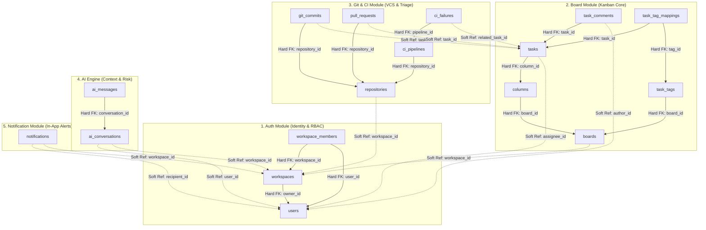

# System Database Architecture & ERD Specification — DevFlow

> **Project:** DevFlow — Intelligent Developer Coordination Platform for Software Teams  
> **Course:** Service-Oriented Program Design  
> **Architecture:** Modular Monolith (Java 17, Spring Boot 3.4.5, PostgreSQL 17)  
> **Version:** 1.0.0 (Milestone M1)  
> **Cross-Reference:** [docs/DATABASE_DESIGN_VI.md](file:///docs/DATABASE_DESIGN_VI.md) (Vietnamese version) | [docs/ARCHITECTURE.md](file:///docs/ARCHITECTURE.md)

---

## 1. Architectural Overview & Service-Oriented Principles

### 1.1. Context & Design Objectives
**DevFlow** integrates 5 core functional domains:
1. **Auth & Identity:** Manages user credentials, authentication sessions, project workspaces, and role-based access control (RBAC).
2. **Board & Task Management:** Manages visual Kanban workflows, progress columns, tasks, comments, and tagging taxonomy.
3. **Git & CI/CD Integration:** Tracks version control systems (GitHub/GitLab), commits, pull requests, webhook events, and CI/CD pipeline failure logs.
4. **AI Engine:** Contextual assistant providing automated root-cause failure analysis, sprint risk assessments, and interactive developer queries.
5. **Notification:** Real-time in-app notification pipeline (supporting WebSocket push and REST query history).

To optimize operational overhead and maintain lean infrastructure during the MVP phase, DevFlow runs on a single shared **PostgreSQL 17** database. However, in terms of logical data modeling, DevFlow strictly enforces the **Logical Database-per-Module** pattern:
- Every business module exclusively owns its tables.
- Cross-module physical foreign keys (`FOREIGN KEY ... REFERENCES`) are strictly forbidden.
- All inter-module relationships are normalized into **Soft References via UUID** coupled with **Public API Interfaces** and **Domain Event Bus** for data synchronization.

---

### 1.2. In-Depth Analysis: Hard Foreign Keys vs Soft Reference UUIDs

In traditional monolith applications, engineers often rely on database-level hard foreign keys for all entity associations. From a **Service-Oriented Architecture (SOA)** perspective, this introduces tight database coupling, preventing any future extraction into independent microservices.

```
[Server 1 — PostgreSQL Instance A]          [Server 2 — PostgreSQL Instance B]
        Module Auth                                  Module Board
       ┌───────────┐                                ┌───────────┐
       │   users   │                                │   tasks   │
       │ (id: u1)  │ < - - - - - - - - - - - - - -  │(assignee) │
       └───────────┘         IMPOSSIBLE!            └───────────┘
                 RDBMS CANNOT ENFORCE FOREIGN KEYS
                   ACROSS NETWORKS (HTTP / RPC)
```

#### A. Under the Hood of the RDBMS Engine:
1. **Data Insertion / Updates (`INSERT / UPDATE` on Child Table):**
   - **Soft Reference (`UUID`):** PostgreSQL writes 16 bytes directly into the table data page and updates the index. Execution completes in microseconds with zero dependency on the parent table.
   - **Hard Foreign Key (`REFERENCES`):** The RDBMS engine suspends the write operation, triggers an internal index lookup on the parent table, and acquires a **Shared Lock (`FOR KEY SHARE`)** on the parent row. Under high concurrency, this creates lock contention and degrades write throughput.
2. **Parent Record Deletion / Modification (`DELETE / UPDATE`):**
   - **Soft Reference:** The parent row is deleted immediately. Child tables experience zero locking and zero index scans.
   - **Hard Foreign Key (`CASCADE / RESTRICT`):** The engine scans the child table. Under `CASCADE`, extensive `Row-Exclusive Locks` are acquired on child rows, creating severe **Deadlock Risks** when multiple developers are modifying board tasks concurrently.
3. **Encapsulation Breakdown with ORMs (Hibernate / JPA):**
   - Physical foreign keys encourage developers to define `@ManyToOne private UserEntity assignee;` inside `TaskEntity`.
   - Consequence: The Board module can directly access `task.getAssignee().getPasswordHash()`, violating data encapsulation and security boundaries.

---

### 1.3. Foreign Key Strategy Matrix

| Criteria | Soft Reference (UUID) | Hard Foreign Key (`REFERENCES`) |
|---|---|---|
| **Nature** | **Passive Data (16-byte value)** | **Active Constraint Enforcement + Internal Locks** |
| **Storage Overhead** | 16 bytes (UUID) | 16 bytes (UUID) + `pg_constraint` catalog entry |
| **Write Performance** | Maximum; independent writes | Slower; requires parent lookup + `FOR KEY SHARE` |
| **Deadlock Risk** | None; transactions are decoupled | High under concurrent write workloads |
| **Microservice Readiness**| 100% extractable to a separate database | Impossible without rewriting schema and application logic |
| **DevFlow Application** | **Inter-module relationships** | **Intra-module relationships (internal only)** |
| **Integrity Mechanism** | **Public API + Domain Events (Eventual Consistency)** | **RDBMS ACID Engine** |

---

## 2. System Entity-Relationship Diagram (ERD)

The complete DevFlow platform comprises **16 tables** distributed across the 5 modules:

### 2.1. High-Level Domain Boundary Diagram

The diagram below highlights module data ownership and soft UUID reference links across service boundaries:



---

### 2.2. Detailed Schema & Attributes (Mermaid Code)
The complete Mermaid ERD source code with all attributes, data types, indexes, and constraints is maintained at:  
👉 **[docs/diagrams/database-erd.mmd](file:///docs/diagrams/database-erd.mmd)**

---

## 3. Comprehensive Data Dictionary (16 Tables Across 5 Modules)

### 3.1. Module 1: Auth & Identity (`auth`)

#### Table `users`
Stores user accounts, credentials, and profile information.

| Column Name | Data Type | Attributes | Description & Constraints |
|---|---|---|---|
| `id` | `UUID` | PK, NOT NULL, DEFAULT `gen_random_uuid()` | Unique user identifier |
| `email` | `VARCHAR(255)` | UK, NOT NULL | Unique login email (`uq_users_email`) |
| `password_hash`| `VARCHAR(255)` | NOT NULL | BCrypt hashed password (`$2a$10$...`) |
| `full_name` | `VARCHAR(255)` | NOT NULL | User's full display name |
| `avatar_url` | `VARCHAR(512)` | NULL | Avatar URL hosted on CDN or Gravatar |
| `status` | `VARCHAR(32)` | NOT NULL, DEFAULT `'PENDING_VERIFICATION'` | Account lifecycle: `PENDING_VERIFICATION`, `ACTIVE` (`ck_users_status`). Only `ACTIVE` accounts can log in. *(V3, T-004A)* |
| `email_verified_at` | `TIMESTAMPTZ` | NULL | When the email address was confirmed *(V3, T-004A)* |
| `password_changed_at` | `TIMESTAMPTZ` | NULL | Last password change (reset), informational *(V10 tentative, T-008)* |
| `token_version` | `INTEGER` | NOT NULL, DEFAULT `0`, CHECK `>= 0` | Embedded in every access and refresh JWT (claim `tv`); a password reset increments it, so every earlier token is rejected regardless of issue time (`ck_users_token_version`, *V10 tentative, T-008*) |
| `created_at` | `TIMESTAMPTZ` | NOT NULL, DEFAULT `CURRENT_TIMESTAMP` | Account creation timestamp |
| `updated_at` | `TIMESTAMPTZ` | NOT NULL, DEFAULT `CURRENT_TIMESTAMP` | Last profile update timestamp |

- **Indexes:** `idx_users_email` on `(email)` (B-Tree, fast login lookup); `idx_users_status_created_at` on `(status, created_at)` (purge of abandoned sign-ups).
- **Migration note:** accounts that existed before V3 were backfilled as `ACTIVE`.

---

#### Table `verification_tokens` *(V3, T-004A)*
Single-use, expiring tokens delivered by email. Only the SHA-256 digest is stored; the raw token exists solely in the emailed link.

| Column Name | Data Type | Attributes | Description & Constraints |
|---|---|---|---|
| `id` | `UUID` | PK, NOT NULL, DEFAULT `gen_random_uuid()` | Token record ID |
| `user_id` | `UUID` | FK, NOT NULL | Internal FK referencing `users(id)` ON DELETE CASCADE |
| `token_hash` | `VARCHAR(64)` | UK, NOT NULL | Hex SHA-256 of the 256-bit raw token (`uq_verification_tokens_hash`) |
| `type` | `VARCHAR(32)` | NOT NULL | Purpose: `EMAIL_VERIFICATION` (TTL 24h) or `PASSWORD_RESET` (TTL 30 min, *T-008*) (`ck_verification_tokens_type`). Issuing a token invalidates the user's unused tokens of the same type |
| `expires_at` | `TIMESTAMPTZ` | NOT NULL | Expiry (default TTL 24h) |
| `used_at` | `TIMESTAMPTZ` | NULL | Set when consumed or superseded by a resend; non-null tokens are rejected |
| `created_at` | `TIMESTAMPTZ` | NOT NULL, DEFAULT `CURRENT_TIMESTAMP` | Issue timestamp |
| `updated_at` | `TIMESTAMPTZ` | NOT NULL, DEFAULT `CURRENT_TIMESTAMP` | Last modification timestamp |

- **Indexes:** `idx_verification_tokens_user_type` on `(user_id, type)`; `idx_verification_tokens_expires_at` on `(expires_at)`; `uq_verification_tokens_open_password_reset` partial UNIQUE on `(user_id) WHERE type = 'PASSWORD_RESET' AND used_at IS NULL` (at most one usable reset link per user; issuance also locks the user row, *T-008*).
- **Retention:** a nightly job deletes tokens expired/used more than 7 days ago, and `PENDING_VERIFICATION` accounts older than 7 days (tokens cascade).

---

#### Table `workspaces`
Project spaces and organizational boundaries.

| Column Name | Data Type | Attributes | Description & Constraints |
|---|---|---|---|
| `id` | `UUID` | PK, NOT NULL, DEFAULT `gen_random_uuid()` | Unique workspace identifier |
| `name` | `VARCHAR(255)` | NOT NULL | Display name (e.g. "DevFlow Core Team") |
| `slug` | `VARCHAR(100)` | UK, NOT NULL | Unique URL slug (`uq_workspaces_slug`, e.g. `devflow-core`) |
| `owner_id` | `UUID` | FK, NOT NULL | Internal FK referencing `users(id)` ON DELETE RESTRICT |
| `created_at` | `TIMESTAMPTZ` | NOT NULL, DEFAULT `CURRENT_TIMESTAMP` | Workspace creation timestamp |
| `updated_at` | `TIMESTAMPTZ` | NOT NULL, DEFAULT `CURRENT_TIMESTAMP` | Last modification timestamp |

- **Indexes:**
  - `idx_workspaces_slug` on `(slug)`.
  - `idx_workspaces_owner_id` on `(owner_id)`.

---

#### Table `workspace_members`
Association table managing workspace memberships and assigned roles.

| Column Name | Data Type | Attributes | Description & Constraints |
|---|---|---|---|
| `id` | `UUID` | PK, NOT NULL, DEFAULT `gen_random_uuid()` | Membership record ID |
| `workspace_id`| `UUID` | FK, NOT NULL | Internal FK referencing `workspaces(id)` ON DELETE CASCADE |
| `user_id` | `UUID` | FK, NOT NULL | Internal FK referencing `users(id)` ON DELETE CASCADE |
| `role` | `VARCHAR(50)` | NOT NULL, DEFAULT `'MEMBER'` | Role: `OWNER`, `ADMIN`, `MEMBER` |
| `created_at` | `TIMESTAMPTZ` | NOT NULL, DEFAULT `CURRENT_TIMESTAMP` | Timestamp when user joined |
| `updated_at` | `TIMESTAMPTZ` | NOT NULL, DEFAULT `CURRENT_TIMESTAMP` | Role modification timestamp |

- **Constraints:** `uq_workspace_member UNIQUE (workspace_id, user_id)`.
- **Indexes:**
  - `idx_workspace_members_workspace` on `(workspace_id)`.
  - `idx_workspace_members_user` on `(user_id)`.

---

#### Table `workspace_invitations` *(V8 tentative, T-007)*
Single-use, expiring invitations to join a workspace. Only the SHA-256 digest of the token is stored; the raw token exists solely in the emailed link.

| Column Name | Data Type | Attributes | Description & Constraints |
|---|---|---|---|
| `id` | `UUID` | PK, NOT NULL, DEFAULT `gen_random_uuid()` | Invitation ID |
| `workspace_id` | `UUID` | FK, NOT NULL | References `workspaces(id)` ON DELETE CASCADE |
| `email` | `VARCHAR(254)` | NOT NULL | Invitee email, lower case (`ck_workspace_invitations_email_lower`) |
| `role` | `VARCHAR(16)` | NOT NULL, DEFAULT `'MEMBER'` | Role granted on accept: `ADMIN`, `MEMBER` (`ck_workspace_invitations_role`; `OWNER` is never invited) |
| `token_hash` | `VARCHAR(64)` | UK, NOT NULL | Hex SHA-256 of the 256-bit raw token (`uq_workspace_invitations_token_hash`) |
| `status` | `VARCHAR(16)` | NOT NULL, DEFAULT `'PENDING'` | `PENDING`, `ACCEPTED`, `REVOKED` (`ck_workspace_invitations_status`); expiry is derived from `expires_at` |
| `invited_by` | `UUID` | FK, NULL | References `users(id)` ON DELETE SET NULL |
| `expires_at` | `TIMESTAMPTZ` | NOT NULL | Expiry (default TTL 7 days) |
| `accepted_at` / `accepted_by` | `TIMESTAMPTZ` / `UUID` | NULL | Set on accept; `accepted_at` is non-null exactly when `status = 'ACCEPTED'` |
| `revoked_at` | `TIMESTAMPTZ` | NULL | Set on revoke; non-null exactly when `status = 'REVOKED'` |
| `created_at` / `updated_at` | `TIMESTAMPTZ` | NOT NULL | Audit timestamps |

- **Indexes:** `uq_workspace_invitations_open` partial UNIQUE on `(workspace_id, email) WHERE status = 'PENDING'` (one open invitation per email; also serves the pending listing); `idx_workspace_invitations_expires_at` on `(expires_at)`.
- **Retention:** the nightly auth cleanup job deletes invitations expired or revoked more than 7 days ago.

---

#### Table `personal_access_tokens` *(V9 tentative, T-038)*
Long-lived, revocable tokens used by AI coding agents (Cursor, Claude Code) on the MCP endpoints (`/sse`, `/mcp/**`) only. The raw token (`dfp_` + 12 hex lookup key + 43-char secret) is shown once at creation; only its SHA-256 digest is stored.

| Column Name | Data Type | Attributes | Description & Constraints |
|---|---|---|---|
| `id` | `UUID` | PK, NOT NULL, DEFAULT `gen_random_uuid()` | Token ID |
| `user_id` | `UUID` | FK, NOT NULL | Owner; references `users(id)` ON DELETE CASCADE |
| `name` | `VARCHAR(100)` | NOT NULL | Owner-chosen label, sanitised, 1-100 visible chars (`ck_personal_access_tokens_name`) |
| `token_prefix` | `VARCHAR(16)` | UK, NOT NULL | Public lookup key `dfp_` + 12 hex (`uq_personal_access_tokens_prefix`, `ck_personal_access_tokens_prefix`); shown in listings |
| `token_hash` | `VARCHAR(64)` | UK, NOT NULL | Hex SHA-256 of the whole raw token, compared in constant time (`uq_personal_access_tokens_hash`) |
| `expires_at` | `TIMESTAMPTZ` | NULL | Optional expiry (1-365 days); NULL never expires; must be after `created_at` (`ck_personal_access_tokens_expiry`) |
| `last_used_at` | `TIMESTAMPTZ` | NULL | Last MCP use, written at most once per 5 minutes per token |
| `revoked_at` | `TIMESTAMPTZ` | NULL | Set on revoke; a revoked token is rejected on the next request |
| `created_at` / `updated_at` | `TIMESTAMPTZ` | NOT NULL | Audit timestamps |

- **Indexes:** `idx_personal_access_tokens_user_live` partial on `(user_id) WHERE revoked_at IS NULL` (owner listing, per-user quota of 10 live tokens).
- **Retention:** the nightly auth cleanup job deletes tokens revoked or expired more than 30 days ago.

---

#### Table `account_deletion_audit` *(V12 tentative, T-009)*
Records that an account was erased (GDPR right to erasure) without keeping who it was: no email, no name, no full IP.

| Column Name | Data Type | Attributes | Description & Constraints |
|---|---|---|---|
| `id` | `UUID` | PK, NOT NULL, DEFAULT `gen_random_uuid()` | Record ID |
| `user_id` | `UUID` | UK, NOT NULL | Id of the erased account (`uq_account_deletion_audit_user`); deliberately no FK, the `users` row no longer exists |
| `deleted_at` | `TIMESTAMPTZ` | NOT NULL | When the account was erased |
| `client_ip_masked` | `VARCHAR(45)` | NULL | Caller IP truncated to the IPv4 /24 or IPv6 /48 (e.g. `203.0.113.0`); NULL if not an IP literal |
| `workspaces_deleted` | `INT` | NOT NULL, DEFAULT `0` | Sole-owned workspaces deleted with the account (`ck_account_deletion_audit_workspaces` >= 0) |
| `created_at` / `updated_at` | `TIMESTAMPTZ` | NOT NULL | Audit timestamps |

- **Erasure flow:** `DELETE /api/v1/auth/me` re-checks the password, refuses (409) while the user owns a workspace with other members, deletes sole-owned workspaces, invitations addressed to the user's email and the `users` row (memberships, verification tokens and personal access tokens cascade; invitation `invited_by` / `accepted_by` become NULL), then publishes `workspace.deleted` / `user.account_deleted` for Board (ARCHITECTURE.md Section 4).

---

### 3.2. Module 2: Board & Task Management (`board`)

#### Table `boards`
Kanban boards owned by a workspace.

| Column Name | Data Type | Attributes | Description & Constraints |
|---|---|---|---|
| `id` | `UUID` | PK, NOT NULL, DEFAULT `gen_random_uuid()` | Board identifier |
| `workspace_id`| `UUID` | NOT NULL | **Soft Reference** pointing to `workspaces.id` (Auth) |
| `name` | `VARCHAR(255)` | NOT NULL | Board name (e.g. "Sprint 1 — Core Features") |
| `description` | `TEXT` | NULL | Board purpose and objectives |
| `is_archived` | `BOOLEAN` | NOT NULL, DEFAULT `FALSE` | Soft archive flag |
| `created_at` | `TIMESTAMPTZ` | NOT NULL, DEFAULT `CURRENT_TIMESTAMP` | Creation timestamp |
| `updated_at` | `TIMESTAMPTZ` | NOT NULL, DEFAULT `CURRENT_TIMESTAMP` | Last update timestamp |

- **Indexes:** `idx_boards_workspace` on `(workspace_id)`.

---

#### Table `columns`
Workflow status columns within a Kanban board.

| Column Name | Data Type | Attributes | Description & Constraints |
|---|---|---|---|
| `id` | `UUID` | PK, NOT NULL, DEFAULT `gen_random_uuid()` | Column identifier |
| `board_id` | `UUID` | FK, NOT NULL | Internal FK referencing `boards(id)` ON DELETE CASCADE |
| `name` | `VARCHAR(100)` | NOT NULL | Column name (e.g. "To Do", "In Progress") |
| `position` | `INT` | NOT NULL | Order index from left to right (0-indexed) |
| `status_category`| `VARCHAR(50)`| NOT NULL | Status bucket: `TODO`, `IN_PROGRESS`, `IN_REVIEW`, `DONE` |
| `created_at` | `TIMESTAMPTZ` | NOT NULL, DEFAULT `CURRENT_TIMESTAMP` | Creation timestamp |
| `updated_at` | `TIMESTAMPTZ` | NOT NULL, DEFAULT `CURRENT_TIMESTAMP` | Last modification timestamp |

- **Indexes:** `idx_columns_board_position` on `(board_id, position)`.

---

#### Table `tasks`
Work items / tickets managed within Kanban columns.

| Column Name | Data Type | Attributes | Description & Constraints |
|---|---|---|---|
| `id` | `UUID` | PK, NOT NULL, DEFAULT `gen_random_uuid()` | Task identifier |
| `column_id` | `UUID` | FK, NOT NULL | Internal FK referencing `columns(id)` ON DELETE CASCADE |
| `title` | `VARCHAR(255)` | NOT NULL | Concise task title |
| `description` | `TEXT` | NULL | Detailed specifications (Markdown supported) |
| `position` | `INT` | NOT NULL | Order within column for drag-and-drop sorting |
| `priority` | `VARCHAR(50)` | NOT NULL, DEFAULT `'MEDIUM'` | Priority level: `LOW`, `MEDIUM`, `HIGH`, `URGENT` |
| `assignee_id` | `UUID` | NULL | **Soft Reference** pointing to `users.id` (Auth) |
| `due_date` | `TIMESTAMPTZ` | NULL | Target deadline timestamp |
| `created_at` | `TIMESTAMPTZ` | NOT NULL, DEFAULT `CURRENT_TIMESTAMP` | Creation timestamp |
| `updated_at` | `TIMESTAMPTZ` | NOT NULL, DEFAULT `CURRENT_TIMESTAMP` | Last modification timestamp |

- **Indexes:**
  - `idx_tasks_column_position` on `(column_id, position)`.
  - `idx_tasks_assignee` on `(assignee_id)`.
  - `idx_tasks_due_date` on `(due_date)`.

---

#### Table `task_comments`
Discussion threads on individual tasks.

| Column Name | Data Type | Attributes | Description & Constraints |
|---|---|---|---|
| `id` | `UUID` | PK, NOT NULL, DEFAULT `gen_random_uuid()` | Comment identifier |
| `task_id` | `UUID` | FK, NOT NULL | Internal FK referencing `tasks(id)` ON DELETE CASCADE |
| `author_id` | `UUID` | NOT NULL | **Soft Reference** pointing to `users.id` (Auth) |
| `content` | `TEXT` | NOT NULL | Markdown comment text |
| `created_at` | `TIMESTAMPTZ` | NOT NULL, DEFAULT `CURRENT_TIMESTAMP` | Timestamp posted |
| `updated_at` | `TIMESTAMPTZ` | NOT NULL, DEFAULT `CURRENT_TIMESTAMP` | Timestamp edited |

- **Indexes:** `idx_task_comments_task_created` on `(task_id, created_at ASC)`.

---

#### Table `task_tags`
Tag taxonomy managed per board.

| Column Name | Data Type | Attributes | Description & Constraints |
|---|---|---|---|
| `id` | `UUID` | PK, NOT NULL, DEFAULT `gen_random_uuid()` | Tag identifier |
| `board_id` | `UUID` | FK, NOT NULL | Internal FK referencing `boards(id)` ON DELETE CASCADE |
| `name` | `VARCHAR(50)` | NOT NULL | Tag label (e.g. `bug`, `feature`, `backend`) |
| `color` | `VARCHAR(20)` | NOT NULL | Hex color or palette key (e.g. `#EF4444`) |

- **Indexes:** `idx_task_tags_board` on `(board_id)`.

---

#### Table `task_tag_mappings`
Many-to-many link between tasks and tags.

| Column Name | Data Type | Attributes | Description & Constraints |
|---|---|---|---|
| `task_id` | `UUID` | FK, NOT NULL | Internal FK referencing `tasks(id)` ON DELETE CASCADE |
| `tag_id` | `UUID` | FK, NOT NULL | Internal FK referencing `task_tags(id)` ON DELETE CASCADE |

- **Constraints:** `PRIMARY KEY (task_id, tag_id)`.
- **Indexes:** `idx_tag_mappings_tag` on `(tag_id)`.

---

### 3.3. Module 3: Git & CI Integration (`gitci`)

**Implemented schema contract (T-020):** [V6__gitci_schema.sql](../backend/app/src/main/resources/db/migration/V6__gitci_schema.sql). V3-V5 are Board migrations; the former V3 Git/CI allocation is obsolete. All five tables have UUID primary keys and `created_at`/`updated_at TIMESTAMPTZ NOT NULL DEFAULT CURRENT_TIMESTAMP`. Writers must update `updated_at`; there is no update trigger. Required names/identifiers are nonblank. SHA values are canonical lowercase 40/64 hex characters, excluding all-zero sentinels. Workspace/task references remain soft UUIDs, not authorization checks.

#### Table `repositories`
VCS repositories linked to a workspace.

| Column Name | Data Type | Attributes | Description & Constraints |
|---|---|---|---|
| `id` | `UUID` | PK, NOT NULL, DEFAULT `gen_random_uuid()` | Repository identifier |
| `workspace_id`| `UUID` | NOT NULL | **Soft Reference** pointing to `workspaces.id` (Auth) |
| `provider` | `VARCHAR(50)` | NOT NULL | VCS Provider: `GITHUB`, `GITLAB` |
| `remote_repo_id`| `VARCHAR(100)`| NOT NULL | Stable opaque provider ID; not a mutable name/slug |
| `name` | `VARCHAR(255)` | NOT NULL | Display repository name |
| `repository_url` | `VARCHAR(2048)` | NOT NULL | Canonical provider URL; ingestion validates host and rejects embedded credentials |
| `webhook_secret_ref`| `VARCHAR(255)`| NOT NULL | Opaque reference to deployment-managed key material, never the plaintext HMAC key |
| `created_at` | `TIMESTAMPTZ` | NOT NULL, DEFAULT `CURRENT_TIMESTAMP` | Creation timestamp |
| `updated_at` | `TIMESTAMPTZ` | NOT NULL, DEFAULT `CURRENT_TIMESTAMP` | Last updated timestamp |

- **Unique:** `uq_repositories_workspace_provider_remote(workspace_id, provider, remote_repo_id)`. Its prefix supports workspace lookup; no redundant single-column index. The same remote repository can be registered in multiple workspaces; webhook routing must select and authenticate the correct integration.

---

#### Table `git_commits`
Commit records synced via webhook deliveries.

| Column Name | Data Type | Attributes | Description & Constraints |
|---|---|---|---|
| `id` | `UUID` | PK, NOT NULL, DEFAULT `gen_random_uuid()` | Commit record identifier |
| `repository_id`| `UUID` | FK, NOT NULL | Internal FK referencing `repositories(id)` ON DELETE CASCADE |
| `sha` | `VARCHAR(64)` | NOT NULL | Unique within repository, never globally |
| `message` | `TEXT` | NOT NULL | Empty allowed; at most 65,536 UTF-8 bytes |
| `author_name` | `VARCHAR(255)` | NULL | Missing/anonymized author allowed; nonblank when supplied |
| `author_email`| `VARCHAR(255)` | NULL | Unverified Git metadata; nonblank when supplied |
| `task_id` | `UUID` | NULL | **Soft Reference** pointing to `tasks.id` (Board) |
| `committed_at`| `TIMESTAMPTZ` | NOT NULL | Timestamp recorded on developer machine |
| `created_at` | `TIMESTAMPTZ` | NOT NULL, DEFAULT `CURRENT_TIMESTAMP` | Ingestion timestamp |

`updated_at` has the common audit definition above. `uq_git_commits_repo_sha UNIQUE(repository_id, sha)` permits shared commits across forks/workspaces.

- **Indexes:**
  - Repository lookup uses the composite unique index prefix.
  - `idx_git_commits_task_id` on `(task_id)`.

---

#### Table `pull_requests`
Pull request status and review tracking.

| Column Name | Data Type | Attributes | Description & Constraints |
|---|---|---|---|
| `id` | `UUID` | PK, NOT NULL, DEFAULT `gen_random_uuid()` | Pull request identifier |
| `repository_id`| `UUID` | FK, NOT NULL | Internal FK referencing `repositories(id)` ON DELETE CASCADE |
| `pr_number` | `INT` | NOT NULL, CHECK > 0 | Remote PR number (e.g. `#12`) |
| `title` | `VARCHAR(255)` | NOT NULL | PR title |
| `source_branch`| `VARCHAR(255)` | NOT NULL | Head branch name (e.g. `feature/T-002`) |
| `target_branch`| `VARCHAR(255)` | NOT NULL | Base branch name (e.g. `main`) |
| `status` | `VARCHAR(50)` | NOT NULL | Status: `OPEN`, `MERGED`, `CLOSED` |
| `task_id` | `UUID` | NULL | **Soft Reference** pointing to `tasks.id` (Board) |
| `pr_url` | `VARCHAR(512)` | NOT NULL | Direct web link to PR |
| `provider_updated_at` | `TIMESTAMPTZ` | NULL | Source version time for future stale-event handling |
| `created_at` | `TIMESTAMPTZ` | NOT NULL, DEFAULT `CURRENT_TIMESTAMP` | Creation timestamp |
| `updated_at` | `TIMESTAMPTZ` | NOT NULL, DEFAULT `CURRENT_TIMESTAMP` | Last status update timestamp |

- **Constraints:** `uq_pr_repo_number UNIQUE (repository_id, pr_number)`.
- **Indexes:**
  - `idx_pull_requests_task_id` on `(task_id)`.
  - `idx_pull_requests_repo_status` on `(repository_id, status)`.

---

#### Table `ci_pipelines`
Continuous integration test suite executions.

| Column Name | Data Type | Attributes | Description & Constraints |
|---|---|---|---|
| `id` | `UUID` | PK, NOT NULL, DEFAULT `gen_random_uuid()` | Pipeline run identifier |
| `repository_id`| `UUID` | FK, NOT NULL | Internal FK referencing `repositories(id)` ON DELETE CASCADE |
| `pipeline_id` | `VARCHAR(100)` | NOT NULL | External CI runner ID (GitHub Actions Run ID) |
| `run_attempt` | `INT` | NOT NULL, DEFAULT 1, CHECK > 0 | One row per run attempt; unique with repository and external run ID |
| `commit_sha` | `VARCHAR(64)` | NOT NULL | Target commit hash |
| `branch` | `VARCHAR(255)` | NOT NULL | Git branch trigger |
| `status` | `VARCHAR(50)` | NOT NULL | `PENDING`, `RUNNING`, `SUCCESS`, `FAILED`, `CANCELLED`, `SKIPPED`, `TIMED_OUT`, `ACTION_REQUIRED`, `NEUTRAL`, `STALE`, `UNKNOWN` |
| `provider_status`, `provider_conclusion` | `VARCHAR(50)` each | NULL | Preserve original provider state independently of normalized status |
| `started_at` | `TIMESTAMPTZ` | NULL | Execution start timestamp |
| `finished_at` | `TIMESTAMPTZ` | NULL | Execution completion timestamp |
| `provider_updated_at` | `TIMESTAMPTZ` | NULL | Source version time |
| `created_at` | `TIMESTAMPTZ` | NOT NULL, DEFAULT `CURRENT_TIMESTAMP` | Ingestion timestamp |

- **Indexes:**
  - `idx_ci_pipelines_repo_status` on `(repository_id, status)`.
  - `idx_ci_pipelines_repo_commit` on `(repository_id, commit_sha)`.

`updated_at` uses the common audit definition. `uq_ci_pipelines_repo_run_attempt UNIQUE(repository_id, pipeline_id, run_attempt)` preserves reruns. `finished_at >= started_at` when both exist. `commit_sha` has no FK: CI may arrive before the commit webhook. Its lookup must include the repository.

---

#### Table `ci_failures`
Detailed breakdown of failed test stages and jobs for AI root-cause analysis.

| Column Name | Data Type | Attributes | Description & Constraints |
|---|---|---|---|
| `id` | `UUID` | PK, NOT NULL, DEFAULT `gen_random_uuid()` | Failure record identifier |
| `pipeline_id` | `UUID` | FK, NOT NULL | Internal FK referencing `ci_pipelines(id)` ON DELETE CASCADE |
| `failure_key` | `VARCHAR(200)` | NOT NULL | Stable per-attempt key, e.g. `job:<provider-job-id>` or `run`; not a display name |
| `stage_name` | `VARCHAR(100)` | NOT NULL | Failed stage name (e.g. `unit-test`) |
| `job_name` | `VARCHAR(100)` | NOT NULL | Specific failing job name |
| `error_summary`| `TEXT` | NULL | At most 8,192 bytes |
| `raw_log_snippet`| `TEXT` | NULL | At most 16,384 bytes; ingestion must redact secrets before writing |
| `raw_log_reference` | `VARCHAR(2048)` | NULL | Opaque log storage reference, not a persisted expiring signed URL |
| `ai_summary` | `TEXT` | NULL | At most 16,384 bytes; GitCI-owned projection populated through domain events, not cross-module SQL |
| `related_task_id`| `UUID` | NULL | **Soft Reference** pointing to `tasks.id` (Board) |
| `created_at` | `TIMESTAMPTZ` | NOT NULL, DEFAULT `CURRENT_TIMESTAMP` | Ingestion timestamp |

- **Indexes:**
  - `uq_ci_failures_pipeline_key UNIQUE(pipeline_id, failure_key)` also supports pipeline lookup.
  - `idx_ci_failures_related_task` on `(related_task_id)`.

`updated_at` uses the common audit definition. Unique keys prevent duplicate rows, not duplicate business events. API permissions, webhook authentication/routing, stale updates, idempotent side effects, redaction, object-log retention and cross-module cleanup belong to later integration tickets. No FK cascades from Auth/Board; consumers must validate workspace scope before using soft references.

---

### 3.4. Module 4: AI Engine (`ai`)

#### Table `ai_conversations`
Chat sessions between developers and AI context agent.

| Column Name | Data Type | Attributes | Description & Constraints |
|---|---|---|---|
| `id` | `UUID` | PK, NOT NULL, DEFAULT `gen_random_uuid()` | Conversation session identifier |
| `workspace_id`| `UUID` | NOT NULL | **Soft Reference** pointing to `workspaces.id` (Auth) |
| `user_id` | `UUID` | NOT NULL | **Soft Reference** pointing to `users.id` (Auth) |
| `title` | `VARCHAR(255)` | NOT NULL | Descriptive conversation title |
| `created_at` | `TIMESTAMPTZ` | NOT NULL, DEFAULT `CURRENT_TIMESTAMP` | Session start timestamp |
| `updated_at` | `TIMESTAMPTZ` | NOT NULL, DEFAULT `CURRENT_TIMESTAMP` | Last interaction timestamp |

- **Indexes:** `idx_ai_conversations_user` on `(workspace_id, user_id)`.

---

#### Table `ai_messages`
Individual prompt and completion messages.

| Column Name | Data Type | Attributes | Description & Constraints |
|---|---|---|---|
| `id` | `UUID` | PK, NOT NULL, DEFAULT `gen_random_uuid()` | Message identifier |
| `conversation_id`| `UUID` | FK, NOT NULL | Internal FK referencing `ai_conversations(id)` ON DELETE CASCADE |
| `sender_type` | `VARCHAR(50)` | NOT NULL | Sender: `USER`, `ASSISTANT`, `SYSTEM` |
| `content` | `TEXT` | NOT NULL | Text content / Markdown / Code block |
| `tokens_used` | `INT` | NOT NULL, DEFAULT 0 | LLM token usage tracking |
| `created_at` | `TIMESTAMPTZ` | NOT NULL, DEFAULT `CURRENT_TIMESTAMP` | Message timestamp |

- **Indexes:** `idx_ai_messages_conv_created` on `(conversation_id, created_at ASC)`.

---

### 3.5. Module 5: Notification (`notification`)

#### Table `notifications`
In-app alerts and activity notifications dispatched to developers.

| Column Name | Data Type | Attributes | Description & Constraints |
|---|---|---|---|
| `id` | `UUID` | PK, NOT NULL, DEFAULT `gen_random_uuid()` | Notification identifier |
| `recipient_id`| `UUID` | NOT NULL | **Soft Reference** pointing to `users.id` (Auth) |
| `workspace_id`| `UUID` | NOT NULL | **Soft Reference** pointing to `workspaces.id` (Auth) |
| `title` | `VARCHAR(255)` | NOT NULL | Short alert title |
| `content` | `TEXT` | NOT NULL | Detailed message body |
| `type` | `VARCHAR(50)` | NOT NULL | Alert type: `TASK_ASSIGNED`, `CI_FAILED`, `RISK_ALERT`, `SYSTEM` |
| `reference_type`| `VARCHAR(50)`| NULL | Target domain entity type: `TASK`, `PIPELINE` |
| `reference_id` | `UUID` | NULL | **Soft Reference** pointing to target task/pipeline |
| `is_read` | `BOOLEAN` | NOT NULL, DEFAULT `FALSE` | Read / unread status flag |
| `created_at` | `TIMESTAMPTZ` | NOT NULL, DEFAULT `CURRENT_TIMESTAMP` | Dispatch timestamp |

- **Indexes:**
  - `idx_notifications_recipient_unread` on `(recipient_id, is_read)`.
  - `idx_notifications_recipient_created` on `(recipient_id, created_at DESC)`.

---

## 4. Inter-Module Data Boundary & Exchange Matrix

Golden Rule: **Zero direct SQL JOINs across module boundaries in Spring Data repositories.** Data composition is achieved via **Public API Interfaces** or **Spring Application Events**.

| Source Table | Foreign Key Field | Target Entity (Module) | Reference Type | Integrity Mechanism & Event Protocol |
|---|---|---|---|---|
| `boards` | `workspace_id` | `workspaces` (Auth) | **Soft UUID** | Board Service calls `AuthApi.isWorkspaceMember(userId, workspaceId)` before create/update operations. |
| `tasks` | `assignee_id` | `users` (Auth) | **Soft UUID** | Task response assembly invokes `AuthApi.findUserSummary(assigneeId)` to enrich profile data without reading `users`. |
| `tasks` | `assignee_id` | `users` (Auth) | **Soft UUID** | When a user leaves a workspace, Auth fires `user.removed_from_workspace`. Board listener clears assignment (`assignee_id = NULL`). |
| `task_comments`| `author_id` | `users` (Auth) | **Soft UUID** | Comment author presentation resolved via `AuthApi.findUserSummary(authorId)`. |
| `repositories`| `workspace_id` | `workspaces` (Auth) | **Soft UUID** | A typed request/decision event must validate integration administrator permissions under the active AGENTS contract; not implemented by the schema. |
| `git_commits` | `task_id` | `tasks` (Board) | **Soft UUID** | T-022 resolves a ticket in repository/workspace scope through a typed event contract; T-023 publishes `git.commit_linked`. No direct Board table/API call under active AGENTS. |
| `pull_requests`| `task_id` | `tasks` (Board) | **Soft UUID** | On merge, GitCI fires `git.pr_merged`. Board listens and automatically transitions task to `status_category = 'DONE'`. |
| `ci_failures` | `related_task_id`| `tasks` (Board) | **Soft UUID** | GitCI validates and persists links/projections through typed events; AI never writes GitCI-owned tables directly. |
| `ai_conversations`| `user_id` / `workspace_id` | `users` / `workspaces` (Auth) | **Soft UUID** | Authenticated via Bearer JWT at the HTTP security gateway layer before reaching AI controllers. |
| `notifications`| `recipient_id`| `users` (Auth) | **Soft UUID** | Notification listener consumes domain events (`board.task_assigned`, `ci.failure_detected`) and writes alerts. |
| `notifications`| `reference_id`| `tasks` / `ci_pipelines` | **Soft UUID** | Web client uses this UUID to deep-link directly to task modal or CI run inspection view. |

---

## 5. Indexing & Query Performance Strategy

To ensure sub-100ms response times without physical relational joins across boundaries:

### 5.1. Unique Indexes
- `users(email)`: Rapid authentication lookup.
- `workspaces(slug)`: Clean workspace URL routing.
- `workspace_members(workspace_id, user_id)`: Prevents duplicate membership records.
- `repositories(workspace_id, provider, remote_repo_id)`: Workspace-scoped integration identity.
- `git_commits(repository_id, sha)`: Repository-scoped commit identity; does not guarantee exactly-once webhook processing.
- `pull_requests(repository_id, pr_number)`: Repository-scoped PR uniqueness.
- `ci_pipelines(repository_id, pipeline_id, run_attempt)`: Run-attempt identity.
- `ci_failures(pipeline_id, failure_key)`: Per-attempt failure identity and parent lookup.

### 5.2. Internal Parent-Child Hierarchy Indexes
- `columns(board_id, position)`: Loads ordered Kanban columns in a single index scan.
- `tasks(column_id, position)`: Optimized for drag-and-drop position reordering.
- `task_comments(task_id, created_at ASC)`: Sequential timeline rendering of task discussions.
- `ci_pipelines(repository_id, status)`: Fast triage of failing builds (`status = 'FAILED'`).
- `ci_failures(pipeline_id)`: Quick retrieval of all failures under a pipeline run.

### 5.3. Soft Reference Foreign Key Indexes
- `tasks(assignee_id)`: Quick lookup of all tasks assigned to a specific developer.
- `git_commits(task_id)` & `pull_requests(task_id)`: Instant retrieval of code activities linked to a ticket.
- `notifications(recipient_id, is_read)`: Instant computation of unread notification counter badge.

---

## 6. Flyway Database Migration Roadmap

```
Phase 1 (M1): V1__init_schema.sql (Auth & Foundation)
  ├── users
  ├── workspaces
  └── workspace_members
        │
        ▼
Phase 2 (M2): V2__board_schema.sql (Kanban Core)
  ├── boards
  ├── columns
  ├── tasks
  ├── task_comments
  ├── task_tags
  └── task_tag_mappings
        │
        ▼
V3-V5: Board audit, task audit and optimistic task version (already allocated)
        │
        ▼
Phase 3 (M3): V6__gitci_schema.sql (Git & CI Integration)
  ├── repositories
  ├── git_commits
  ├── pull_requests
  ├── ci_pipelines
  └── ci_failures
        │
        ▼
V7__auth_email_verification.sql (T-004A, Auth hardening; runs after Board V3-V5 and Git/CI V6)
  ├── users.status, users.email_verified_at
  └── verification_tokens
        │
        ▼
Phase 4 (M4): next unused version (V8+) for AI & Notification (not yet allocated)
  ├── ai_conversations
  ├── ai_messages
  └── notifications
```

> **Version numbers are claimed in merge order.** `V3` was taken by the auth email-verification migration (T-004A), so the Git/CI and AI/Notification scripts shift to `V4` and `V5`. Before adding a migration, check `db/migration` on `develop` for the next free number.

1. **Phase 1 (Milestone M1 — Completed):**
   - Script: `backend/app/src/main/resources/db/migration/V1__init_schema.sql`
   - Tables: `users`, `workspaces`, `workspace_members`.
   - Status: **Verified and 100% compliant with this architecture specification.**
2. **Phase 2 (Milestone M2 — Sprint 2 & 3):**
   - Script: `V2__board_schema.sql`
   - Tables: 6 Board module tables.
   - Requirement: `tasks.assignee_id` MUST be declared as `UUID NULL` without `REFERENCES users(id)`.
3. **Phase 3 (Milestone M3 — Sprint 4):**
   - Script: `V6__gitci_schema.sql` (historical T-020 title says V3; V3-V5 must remain immutable).
   - Tables: 5 Git/CI module tables.
   - Requirement: `git_commits.task_id` and `pull_requests.task_id` MUST be declared as `UUID NULL`.
   - Auth hardening (T-004A): `V7__auth_email_verification.sql` adds `users.status`, `users.email_verified_at` and `verification_tokens`.
   - Workspace invitations (T-007): `V8__auth_workspace_invitations.sql` adds `workspace_invitations`.
   - MCP personal access tokens (T-038): `V9__auth_personal_access_tokens.sql` adds `personal_access_tokens`.
   - Password reset (T-008): `V10__auth_password_reset_token_type.sql` (number tentative, assigned at merge) allows `verification_tokens.type = 'PASSWORD_RESET'`, adds `uq_verification_tokens_open_password_reset`, `users.token_version` and `users.password_changed_at`.
   - Account deletion (T-009): `V12__auth_account_deletion_audit.sql` (number tentative, assigned at merge) adds `account_deletion_audit`.
4. **Phase 4 (Milestone M4 — Sprint 5):**
   - Script: allocate the next unused version (V8+) when implementing AI/Notification; do not reuse V4-V7.
   - Tables: 2 AI module tables and 1 Notification module table.

---

## 7. Consistency Audit Report (`V1__init_schema.sql` vs Architecture)

| Audit Item | Implemented in `V1__init_schema.sql` | Database Architecture Specification | Result |
|---|---|---|---|
| Extension Setup | `CREATE EXTENSION IF NOT EXISTS "pgcrypto";` | Required for `gen_random_uuid()` | **100% Match** |
| `users` Table | 7 columns: PK `id UUID`, UK `email`, `password_hash`, `full_name`, `avatar_url`, `created_at`, `updated_at` | Identical schema | **100% Match** |
| `workspaces` Foreign Key | `owner_id UUID REFERENCES users(id) ON DELETE RESTRICT` | Internal intra-module Hard FK | **100% Match** |
| `workspace_members` Structure | Internal FK `workspace_id` CASCADE, `user_id` CASCADE, UK `(workspace_id, user_id)` | Identical schema | **100% Match** |
| Auth Indexes | `idx_users_email`, `idx_workspaces_slug`, `idx_workspaces_owner_id`, `idx_workspace_members_workspace`, `idx_workspace_members_user` | All required indexes present | **100% Match** |

**Conclusion:** The initial Flyway migration script `V1__init_schema.sql` perfectly adheres to this database architecture specification.
