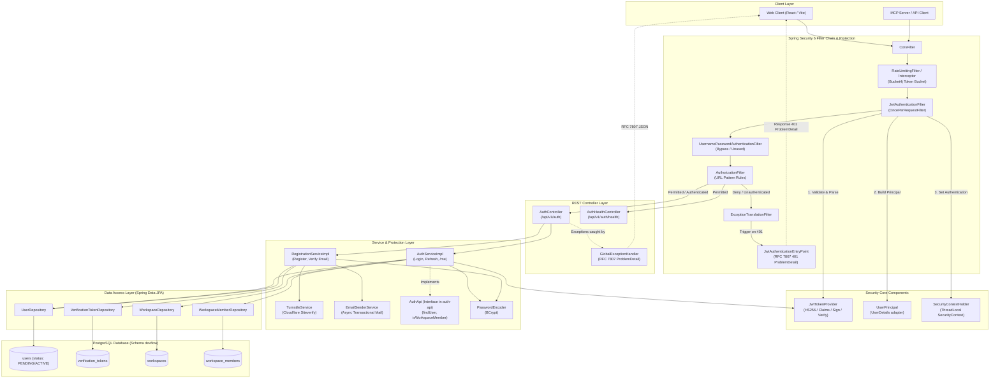
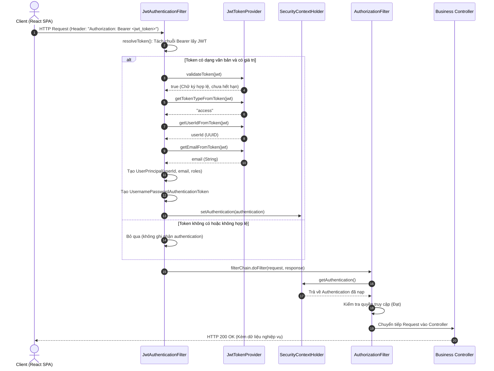
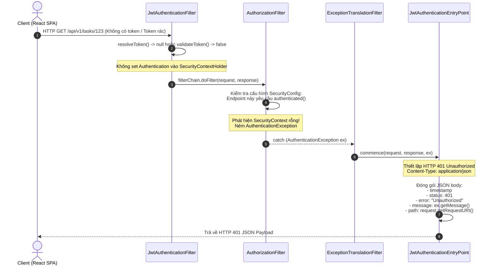
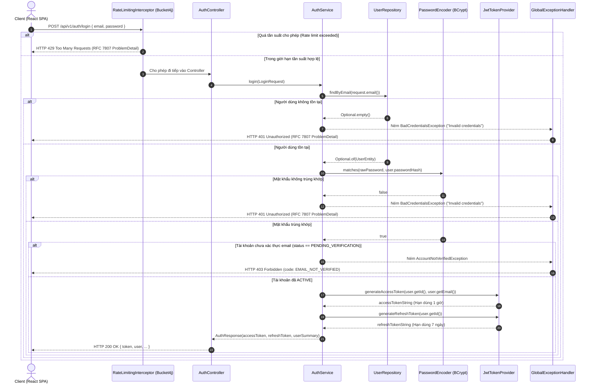
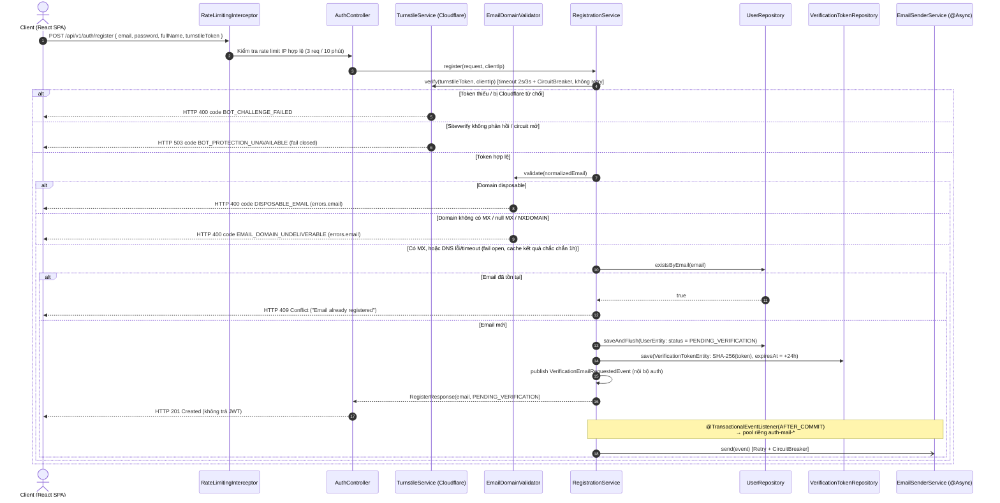
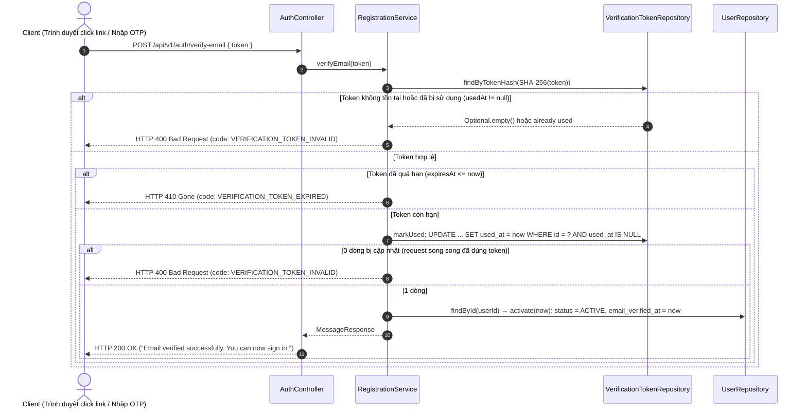
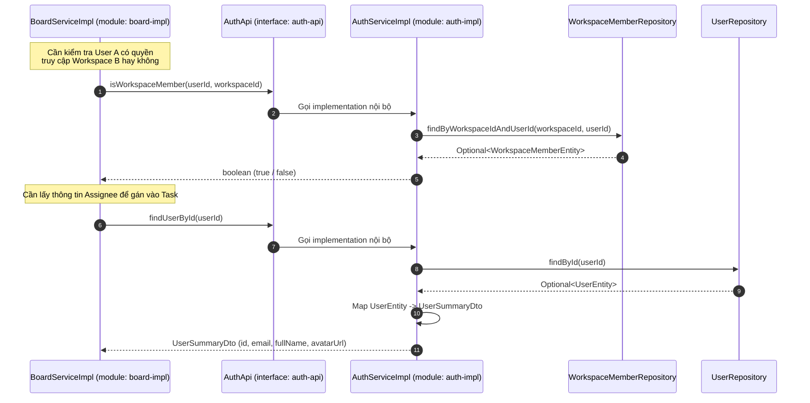

# DevFlow — Kiến trúc Chi tiết Module Auth & Các Luồng Xử lý

> 🌐 **Tài liệu đặc tả kiến trúc thành phần và các luồng tương tác bảo mật của module `auth`**  
> Phiên bản: 1.1 (Cập nhật chuẩn Production SaaS: Phân tách các ticket `T-004`, `T-004A`, `T-004B`)  
> Phạm vi: `backend/auth-api` và `backend/auth-impl`

---

## 1. Sơ đồ Kiến trúc Thành phần (Component Architecture)

Module `auth` chịu trách nhiệm quản lý danh tính người dùng (Users), không gian làm việc (Workspaces), quyền thành viên (Workspace Members), quy trình xác thực email (Verification Tokens), cơ chế phòng chống bot (Turnstile) và cung cấp cơ chế bảo mật xác thực phi trạng thái (Stateless JWT) cho toàn bộ ứng dụng DevFlow.

---

## 2. Luồng Xử lý 1: Request Hợp lệ Gửi Kèm JWT Token

Áp dụng cho mọi API được bảo vệ (ví dụ: `GET /api/v1/boards`, `GET /api/v1/auth/me`).

---

## 3. Luồng Xử lý 2: Request Bị Từ Chối Xác Thực (Xử lý HTTP 401)

Khi Client không gửi token, token hết hạn, hoặc chữ ký token không đúng khi truy cập vào một tài nguyên yêu cầu xác thực (`.anyRequest().authenticated()`).

---

## 4. Luồng Xử lý 3: Đăng nhập Người dùng (`POST /api/v1/auth/login` - Ticket `T-004`)

Luồng đăng nhập được bảo vệ bởi bộ đệm giới hạn tần suất (Rate Limiter) và bắt buộc tài khoản phải ở trạng thái `ACTIVE` (đã qua bước xác thực email).

> **Thứ tự kiểm tra (T-004A):** mật khẩu được kiểm tra **trước** trạng thái tài khoản. Nhờ vậy chỉ người biết đúng mật khẩu mới biết được email đó đã xác thực hay chưa; sai mật khẩu luôn trả 401 chung.

---

## 5. Luồng Xử lý 4: Đăng ký Tài khoản, Chống Bot & Gửi Mail Xác thực (`T-004A` & `T-004B`)

Đảm bảo ngăn chặn bot tự động đăng ký, lọc email dùng một lần và kích hoạt quy trình gửi email xác thực bất đồng bộ.

---

## 6. Luồng Xử lý 5: Kích hoạt Tài khoản qua Email (`POST /api/v1/auth/verify-email` - `T-004A`)

Xác nhận mã/token xác thực được gửi qua email để nâng cấp tài khoản sang trạng thái `ACTIVE`.

### 6.1. Gửi lại email xác thực (`POST /api/v1/auth/resend-verification` - `T-004A`)

- Giới hạn tần suất 2 lớp: theo IP (interceptor, 5 req/giờ) và theo **địa chỉ email** (3 req/giờ) để chặn việc spam một hộp thư từ nhiều IP.
- Nếu email thuộc tài khoản `PENDING_VERIFICATION`: vô hiệu mọi token cũ (`used_at = now`), phát token mới và gửi email.
- **Luôn trả HTTP 202 với cùng một nội dung**, dù email không tồn tại hay đã `ACTIVE`, nên endpoint này không thể dùng để dò email đã đăng ký.

### 6.2. Dọn dữ liệu định kỳ

`VerificationCleanupJob` (cron `devflow.verification.purge-cron`, mặc định 03:00 UTC) xóa token hết hạn hoặc đã dùng quá 7 ngày, và tài khoản `PENDING_VERIFICATION` quá 7 ngày (token bị xóa theo `ON DELETE CASCADE`).

---

## 7. Luồng Xử lý 6: Giao tiếp Liên Module qua Interface `AuthApi`

Các module khác (như `board-impl`, `git-impl`) không được phép gọi trực tiếp JPA Entity hay Repo của Auth mà phải đi qua interface `AuthApi` nằm trong `auth-api`.

---

## 8. Bảng Ánh xạ Thành phần Mã Nguồn (Code Mapping)

| Thành phần | Đường dẫn mã nguồn | Ticket | Vai trò / Trách nhiệm chính |
|---|---|---|---|
| **Security Configuration** | [SecurityConfig.java](file:///c:/Users/Tien/university/ServiceOrientedProgramDesign/DevFlow/backend/auth-impl/src/main/java/io/devflow/auth/internal/SecurityConfig.java) | `T-003` | Định nghĩa `SecurityFilterChain`, các URL `permitAll()` vs `authenticated()`, đăng ký Filter. |
| **Authentication Filter** | [JwtAuthenticationFilter.java](file:///c:/Users/Tien/university/ServiceOrientedProgramDesign/DevFlow/backend/auth-impl/src/main/java/io/devflow/auth/internal/security/JwtAuthenticationFilter.java) | `T-003` | Bóc tách Bearer token, gọi validator, tạo `UserPrincipal` và nạp vào `SecurityContextHolder`. |
| **Token Provider** | [JwtTokenProvider.java](file:///c:/Users/Tien/university/ServiceOrientedProgramDesign/DevFlow/backend/auth-impl/src/main/java/io/devflow/auth/internal/security/JwtTokenProvider.java) | `T-003` | Ký token HMAC SHA-256, parse claims, kiểm tra hạn dùng access/refresh token. |
| **Exception Handler & EntryPoint** | `JwtAuthenticationEntryPoint.java`, `GlobalExceptionHandler.java` | `T-004` | Xử lý lỗi toàn cục và định dạng phản hồi chuẩn RFC 7807 `ProblemDetail`, giấu stack trace. |
| **Rate Limiter** | `security/RateLimitingInterceptor.java`, `RateLimiterService.java`, `RateLimitProperties.java` | `T-004`, `T-004A` | Token Bucket (Bucket4j) theo policy có tên (`devflow.rate-limit.policies.*`), bucket lưu trong Caffeine có TTL. IP lấy từ `getRemoteAddr()`; `X-Forwarded-For` chỉ được tin qua `server.forward-headers-strategy` (proxy nội bộ). |
| **REST Controller** | [AuthController.java](file:///c:/Users/Tien/university/ServiceOrientedProgramDesign/DevFlow/backend/auth-impl/src/main/java/io/devflow/auth/internal/AuthController.java) | `T-004`, `T-004A` | Endpoints cho Login, Refresh, Me, Workspaces, Register, Verify Email, Resend Verification. |
| **Core Auth Service** | [AuthService.java](file:///c:/Users/Tien/university/ServiceOrientedProgramDesign/DevFlow/backend/auth-impl/src/main/java/io/devflow/auth/internal/AuthService.java) | `T-004`, `T-004A` | Xử lý đăng nhập, cấp token JWT, chặn tài khoản chưa `ACTIVE` (login & refresh) và cài đặt `AuthApi`. |
| **Registration Service** | `RegistrationService.java` | `T-004A` | Tạo user `PENDING_VERIFICATION`, phát token, verify (consume nguyên tử), resend chống dò email. |
| **Verification Infrastructure** | `verification/VerificationTokenGenerator.java`, `VerificationEmailListener.java`, `VerificationEmailSender.java`, `VerificationCleanupJob.java`, `VerificationProperties.java` | `T-004A` | Token 256-bit + SHA-256; gửi mail sau commit qua pool riêng; SMTP với Resilience4j Retry/CircuitBreaker; template `templates/email/verify-email.{html,txt}`; job dọn dữ liệu hằng đêm. |
| **Anti-Abuse & Bot Service** | `antiabuse/TurnstileService.java`, `antiabuse/EmailDomainValidator.java`, `antiabuse/JndiMxLookup.java`, `resources/anti-abuse/disposable-email-domains.txt` | `T-004B` | Kiểm tra token Cloudflare Turnstile (fail closed), lọc disposable email (gồm subdomain + `REGISTRATION_EXTRA_BLOCKED_DOMAINS`), kiểm tra bản ghi DNS MX (fail open khi DNS lỗi). Metric `devflow.auth.anti_abuse{check,result}`. |
| **JPA Entities & Repositories** | `entity/UserEntity.java`, `VerificationTokenEntity.java`, `WorkspaceEntity.java` | `T-002`, `T-004A` | Quản lý dữ liệu bảng `users` (thêm `status`), `verification_tokens`, `workspaces`, `workspace_members`. |

